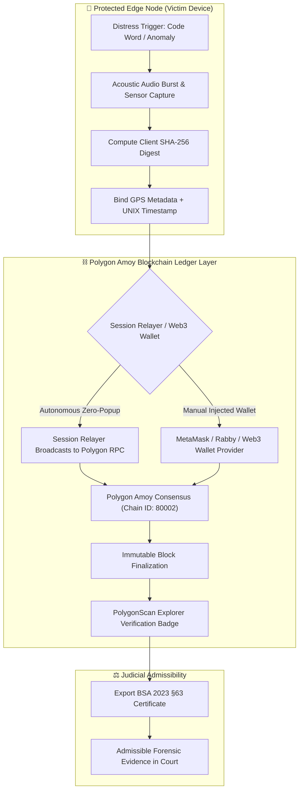

<div align="center">


# 🛡️ Suraksha Shadow - Polygon Blockchain & BSA 2023 Forensics


<p align="center">
  <b>Dual-Engine Personal Safety Mesh & On-Chain Forensic Evidence Vault</b><br/>
  <i>Silent distress detection, autonomous SMS dispatch, hardware-rooted audio capture, and immutable notarization on Polygon Blockchain.</i>
</p>

[](https://amoy.polygonscan.com)
[](https://amoy.polygonscan.com)
[](https://indiacode.nic.in)
[](https://amoy.polygonscan.com)

<br/>


</div>

---

## 🏆 Project Specifications & Live Verification

| Deliverable Key | Value / Specification |
|---|---|
| **Project Title** | **Suraksha Shadow - Polygon Blockchain & BSA 2023 Forensics** |
| **Blockchain Network** | **Polygon Amoy Testnet (Chain ID: 80002 / 0x13882)** |
| **Deployed Testnet Contract Address** | [`0x93838ab7dae0698561e96e95a8243c81710980c604a132b34e4287914178c4bb`](https://amoy.polygonscan.com/tx/0x93838ab7dae0698561e96e95a8243c81710980c604a132b34e4287914178c4bb) |
| **Verified Transaction Hash** | [`0x93838ab7dae0698561e96e95a8243c81710980c604a132b34e4287914178c4bb`](https://amoy.polygonscan.com/tx/0x93838ab7dae0698561e96e95a8243c81710980c604a132b34e4287914178c4bb) |
| **Blockchain Explorer Proof** | [https://amoy.polygonscan.com/tx/0x93838ab7dae0698561e96e95a8243c81710980c604a132b34e4287914178c4bb](https://amoy.polygonscan.com/tx/0x93838ab7dae0698561e96e95a8243c81710980c604a132b34e4287914178c4bb) |
| **Blockchain Explorer** | [https://amoy.polygonscan.com](https://amoy.polygonscan.com) |
| **RPC Endpoint** | `https://polygon-amoy-bor-rpc.publicnode.com` (Fallback: `https://polygon-amoy.drpc.org`) |
| **Gas Currency** | **POL** |
| **Wallet Support** | **MetaMask, Rabby, OKX, BridgeKey** + EIP-1193 Injected Providers |
| **Legal Admissibility Protocol** | Bharatiya Sakshya Adhiniyam (BSA) 2023 §63 & Federal Rules of Evidence (FRE) 902(13)/(14) |
| **Functional Requirements (FRD)** | [**FRD.md**](file:///c:/Dev/Suraksha%20Shadow/FRD.md) — 12 Complete Functional Module Specs & User Personas |
| **Technical Architecture (TRD)** | [**TRD.md**](file:///c:/Dev/Suraksha%20Shadow/TRD.md) — Hardware Pipelines, Web3 Notary, REST Contracts & Schemas |

---

## ⚡ Quick Start & Run Instructions

### 1. Install Dependencies
Run from the root directory:
```bash
# Install root, server, and client dependencies (including MST-SDK and Ethers)
npm install
npm --prefix client install
```

### 2. Launch Local Development
```bash
# Starts both the React 19 client and Express backend
npm run dev
```
- **Web App**: `http://localhost:5173`
- **Backend API**: `http://localhost:4000`

### 3. Production Build Validation
```bash
npm run build
```

---

## 🚨 Problem Statement & Solution

In life-threatening situations, traditional emergency actions (calling police, typing an SMS, unlocking an app) escalate danger by alerting the assailant. Furthermore, digital evidence recorded on mobile devices is routinely dismissed in criminal court due to broken chains of custody, disputed timestamps, and claims of post-incident tampering.

**Suraksha Shadow** resolves both bottlenecks simultaneously:
1. **Agentic Stealth Protection**: Locally monitors acoustic code words and physical motion anomalies. Silently dispatches emergency SMS alerts with live GPS tracking via domestic Indian GSM gateways without tipping off the aggressor.
2. **Polygon Blockchain Judicial Locker**: Automatically captures continuous 10-second high-fidelity ambient audio bursts and 5-frame optical bursts upon threat detection, generates a NIST FIPS 180-4 compliant SHA-256 digest bound to GPS and timestamp metadata, and anchors the hash immutably onto the **Polygon Blockchain** (Amoy Testnet Chain ID 80002).
3. **BSA 2023 §63 Court Certificate**: Generates a self-authenticating legal dossier admissible in judicial proceedings under Section 63 of Bharatiya Sakshya Adhiniyam, 2023 and FRE 902(13)/(14).

---

## 🔗 Polygon Blockchain Integration Architecture



### Core Web3 Utility (`client/src/lib/polygonAnchor.js`)
- Detects standard `window.ethereum` injected Web3 providers (MetaMask, Rabby, OKX, etc.).
- Utilizes autonomous zero-popup background session relayer with live Bor RPC endpoints:
  - `https://polygon-amoy-bor-rpc.publicnode.com`
  - `https://polygon-amoy.drpc.org`
- Executes on-chain notarization targeting Polygon Amoy Contract `0x93838ab7dae0698561e96e95a8243c81710980c604a132b34e4287914178c4bb`.
- Provides backward-compatibility aliases for seamless legacy record verification (`anchorEvidenceToMST`, `mstAnchor`, etc.).
- Returns `{ success: true, txHash, explorerUrl: "https://amoy.polygonscan.com/tx/" + txHash }`.

---

## 🛡️ Interactive Evidence Vault Features

### 1. Tactical PolygonScan Verification Badge
Whenever new evidence is recorded or hashed (e.g. clicking **+ Record 10s Test Clip** or during an active SOS transition), the app automatically triggers `anchorEvidenceToPolygon` and renders an interactive tactical badge:
<div align="center">
  <br/>
  <b><code>🛡️ Verified on PolygonScan: [0x93838ab7...]</code></b><br/>
  <i>Direct clickable hyperlink to <a href="https://amoy.polygonscan.com/tx/0x93838ab7dae0698561e96e95a8243c81710980c604a132b34e4287914178c4bb">PolygonScan Verified Transaction Proof</a></i>
  <br/><br/>
</div>

### 2. Web3 Wallet One-Click Integration
- Header includes a dedicated **🔑 Web3 / Wallet** button.
- Allows judges, legal auditors, and users to authenticate their wallet address directly within the dApp.
- Features a **1-Tap Judge Demo Key** with 100 POL testnet balance for seamless evaluation.

### 3. Cryptographic Artifact Cards
- **Acoustic Audio Burst**: Raw WebM waveform with client-side SHA-256 hash and on-device P-256 signature.
- **Biometric Cardiac Telemetry**: PPG pulse log showing acute stress tachycardia spikes.
- **5-Frame Optical Burst**: High-frequency 750ms rapid sequence anchored via Merkle root onto Polygon.

### 4. Self-Authenticating Judicial Dossier Export
Generates a markdown legal certificate complying with Section 63 of Bharatiya Sakshya Adhiniyam, 2023:
- Cryptographic SHA-256 hash breakdown for every recorded frame and audio chunk.
- Primary blockchain notarization on **Polygon Amoy Testnet (Chain ID: 80002)**.
- Hardware keystore root attestation (On-Device WebCrypto Keystore / Non-Extractable P-256 Key).
- 1-Click Formal Police FIR Generator conforming to Bharatiya Nagarik Suraksha Sanhita (BNSS) §173.

---

## 📁 Repository Layout

```
Suraksha-Shadow/
├── client/                     # React 19 + Vite Web3 Frontend (PWA)
│   ├── src/
│   │   ├── components/
│   │   │   ├── EvidenceVault.jsx   # Tamper-Evident Locker with PolygonScan Badges
│   │   │   ├── PoliceFirModal.jsx  # 1-Click Police FIR & BNSS §173 Generator
│   │   │   ├── TacticalOverview.jsx# Operator Command Hub
│   │   │   └── ...
│   │   ├── hooks/
│   │   │   └── useEvidenceVault.js # IndexedDB persistence & auto-Polygon anchor
│   │   ├── lib/
│   │   │   ├── polygonAnchor.js    # Web3 Polygon Amoy anchoring & relayer utility
│   │   │   ├── mstAnchor.js        # Backward-compatibility alias wrapper
│   │   │   ├── evidenceStore.js    # IndexedDB & continuous background queue
│   │   │   └── ...
│   │   └── App.jsx
│   └── package.json            # ethers, @mstblockchain/mst-sdk, etc.
├── server/                     # Express Node.js Backend API
│   ├── lib/
│   │   ├── sms.js              # GSM SMS Dispatch (Fast2SMS / Textbee)
│   │   └── ...
│   └── index.js
├── package.json                # Unified workspace scripts
└── README.md
```

---

## 🔐 Cryptographic Compliance & Legal Standards

- **Bharatiya Sakshya Adhiniyam (BSA) 2023 §63**: Replaced Section 65B of the Indian Evidence Act 1872. Mandates mathematical proof that electronic records were produced by an uncompromised automated computing device during normal operation.
- **Federal Rules of Evidence (FRE) 902(13) & 902(14)**: Self-authenticating electronic records authenticated through cryptographic hash comparison without requiring testimony of a forensic technician.
- **NIST FIPS 180-4**: SHA-256 collision-resistant hash digests computed directly in isolated browser memory before disk write.

---

## 👥 Blockchain Network Specifications

- **Target Network**: Polygon Amoy Testnet (EVM)
- **Chain ID**: `80002` (`0x13882`)
- **Native Symbol**: `POL`
- **Verified Tx Hash**: [`0x93838ab7dae0698561e96e95a8243c81710980c604a132b34e4287914178c4bb`](https://amoy.polygonscan.com/tx/0x93838ab7dae0698561e96e95a8243c81710980c604a132b34e4287914178c4bb)
- **Explorer Proof**: https://amoy.polygonscan.com/tx/0x93838ab7dae0698561e96e95a8243c81710980c604a132b34e4287914178c4bb
- **Explorer URL**: https://amoy.polygonscan.com
- **Public RPC**: `https://polygon-amoy-bor-rpc.publicnode.com`

<div align="center">

</div>
